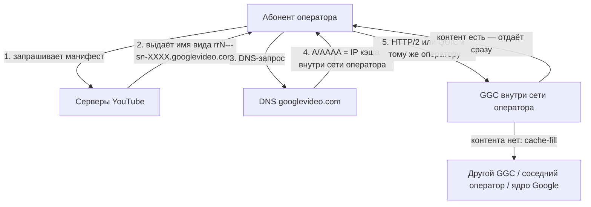

# Google Global Cache в России

**Коротко.** Google раздаёт операторам связи серверы-кэши и ставит их прямо внутрь сети оператора — чтобы видео и другой «тяжёлый» контент не уходил в магистраль. В России эта программа работала с начала 2010-х; к июлю 2024 года у шести крупнейших операторов стояло больше тысячи таких серверов, а к концу 2025-го осталось около 930 живых. При этом с 2024 года трафик YouTube через локальные кэши почти перестал ходить — но не потому, что железо сломалось, а из-за фильтрации ТСПУ и динамики маршрутизации самого Google.

Ниже — как GGC устроен технически, как проверить свой узел, хроника событий в РФ и наблюдения сетевых инженеров с профильного форума ntc.party (включая свежие данные осени 2026 года).

*Обзор составлен по официальной документации и открытым источникам (ссылки в конце). Состояние на октябрь 2026 года.*

---

## Что такое GGC

Google Global Cache — это кэширующие серверы Google, которые стоят не в дата-центрах компании, а **внутри сети интернет-провайдера**. Google привозит железо, а оператор даёт стойку, питание, охлаждение, клавиатуру с монитором и подключение к своей сети. Дальше Google управляет серверами удалённо ([Introduction to GGC](https://support.google.com/interconnect/answer/9058809?hl=en)).

Смысл простой: если популярное видео уже скачал другой абонент этого же оператора, второму оно отдаётся не из-за границы, а с сервера в соседнем зале. Оператор экономит на транзите, абонент получает видео быстрее. По оценке Google, **70–90% кэшируемого трафика** отдаётся именно так; точная доля зависит от того, что смотрят абоненты конкретной сети.

Через GGC идёт не только YouTube, но и Google Play, обновления Android, картинки поиска, шрифты и прочая статика.

---

## Как запрос попадает на локальный кэш

Важно понимать: GGC — **не anycast**. Никакой «ближайший маршрут» пакетов тут не работает. Google управляет раздачей на уровне приложения и DNS: серверы YouTube сами решают, на какой узел отправить клиента, и выдают ему имя этого узла, а DNS просто резолвит это имя в обычный IP-адрес.



**Зачем тогда BGP?** Он нужен не для раздачи, а чтобы Google знал, какие адреса принадлежат какому оператору. Оператор поднимает BGP-сессию с узлом Google и **анонсирует в его сторону свои абонентские подсети** — так Google строит карту «этот префикс обслуживает такой-то кластер». При желании анонсы помечают тегами: `15169:12000` означает «здесь стоит NAT», `15169:12100` — «здесь за NAT пользователи» ([Carrier Grade NAT](https://support.google.com/interconnect/answer/7658745?hl=en)). Набор узлов, которые обслуживают одних и тех же абонентов с одинаковой политикой отказа, Google называет **GNL** (GGC Network Location) — у всех узлов одного GNL должны быть одинаковые анонсы и теги.

**Наполнение кэша (cache-fill)** — иерархическое ([Cache-Fill](https://support.google.com/interconnect/answer/7658593?hl=en)). Кэши никто заранее не заполняет: сервер скачивает контент по мере спроса. Источник заливки Google выбирает динамически — это может быть другой кэш в сети того же оператора, кэш у соседнего оператора или ядро Google. Есть и peer-to-peer заливка: один GGC тянет контент с другого, если тот проанонсировал свой префикс. Здесь есть тонкость, критически важная для работы в РФ: в документации Google прямо сказано, что если фильтры или ACL нарушают связность между сетями, peer-to-peer cache-fill может ломаться без очевидных внешних причин.

---

## Как проверить, откуда у вас приходит видео

Google держит для этого служебную страницу. Достаточно открыть её в браузере (или через `curl`):

```bash
curl -4 -s "https://redirector.googlevideo.com/report_mapping?di=no"
```

Ответ выглядит так:

```text
85.249.22.12 => vimpelcom-iar2 (85.249.20.0/22)
```

Слева — ваш внешний IP, справа — кластер, который вам назначен. Имя кластера собирается по шаблону `оператор-IATA+номер`:

- `vimpelcom` — оператор в терминах Google (у МТС это `comstar`, у «Ростелекома» — `rostelecom`, у «МегаФона» — `megafon`, у ТТК — `transtelecom`, у «Дом.ру» — `ertelecom`);
- `iar` — IATA-код ближайшего аэропорта (`iar` — Ярославль, `svo`/`dme`/`vko` — Москва, `led` — Санкт-Петербург, `goj` — Нижний Новгород, `skx` — Саранск, `ovb` — Новосибирск);
- `2` — номер кластера в этой локации.

Если в ответе стоит зарубежный код — например, `arn09s18` (Стокгольм), `fra16s48` (Франкфурт), `ams` (Амстердам) или `hel` (Хельсинки), — значит локального кэша сейчас нет и видео перенаправлено на внешние дата-центры Google. Сравнение ответа до и после включения VPN — прямой тест, ушли ли вы с локального кэша за границу.

Второй способ — посмотреть реальные соединения в браузере (F12 → Network). Найдите запрос к `videoplayback`, посмотрите его заголовок `:authority:` (например, `r2---sn-5uaezn6k.googlevideo.com`) и реальный Remote IP:
1. Если IP принадлежит провайдеру или подсетям Google в РФ (например, московские адреса `svo*` из пула `2a00:1450:4011::`), видео идёт из России.
2. Базы Whois/2ip для многих IP Google часто ошибочно показывают «Ирландия», «США» или «Канада» из-за юридической регистрации подсетей. Реальную геопозицию выдаёт только пинг: RTT до 20–30 мс означает, что сервер физически находится в Москве или вашем регионе, а не за океаном.

---

## GGC в России: как всё начиналось

Программа развивалась с начала 2010-х. К 2012 году крупные операторы уже выстроили с Google системное взаимодействие: логистику, поддержку, гарантийную замену железа. Размещение шло по одной из трёх схем (их описывал инженер оператора связи в [разборе на Habr](https://habr.com/ru/articles/828762/)):

1. Google присылает только серверы, BGP-сессия поднимается с приватной AS 65535.
2. То же самое, но BGP-сессия с AS 11344.
3. Google присылает серверы **и** маршрутизатор, BGP-сессия — с AS 36040, а подсеть под серверы прописывается статикой.

Адресный план у всех схем одинаковый: адреса на физические серверы и отдельные виртуальные адреса (`r1`, `r2`, …), на которых работает HTTPS. Зная IP виртуального адреса, с помощью ping со смещением вычисляется количество реальных железных серверов в кластере (их в одной стойке не больше восьми).

К июлю 2024 года по этой методике насчитали **1140 серверов** у шести крупнейших операторов:

| Оператор | Серверов | Городов |
|---|---:|---:|
| Ростелеком | 348 | 54 |
| ВымпелКом (билайн) | 214 | 42 |
| МТС | 176 | 15 |
| МегаФон + НетБайНет | 147 | 22 |
| ЭрТелеком (Дом.ру) | 133 | 34 |
| Транстелеком | 122 | 27 |

Метод даёт нижнюю оценку: у операторов «второго эшелона» серверы тоже есть (+20–25% к найденному), плюс стойки самого Google на точках обмена в Москве и Петербурге. Суммарно по РФ было порядка 1400–1500 серверов.

Давление регулятора началось задолго до 2024 года: в 2017-м Роскомнадзор публично обсуждал планы ограничить GGC, а в 2018-м выставлялись штрафы за использование несертифицированных комплексов ([ru.wikipedia](https://ru.wikipedia.org/wiki/Google_Global_Cache)). В мае 2022 года Google прекратил поставки нового оборудования после банкротства российского юрлица ООО «Гугл».

---

## 2024: почему «деградация GGC» стала официальной версией

Летом 2024 года YouTube в России подвергся резкому замедлению:

* **Официальная версия:** «деградация серверов GGC» из-за отсутствия обновлений и износа дисков (заявление «Ростелекома» от 12 июля 2024 года, поддержанное РКН и Госдумой).
* **Техническая реальность:** искусственное замедление через комплексы ТСПУ (технические средства противодействия угрозам, установленные у операторов по закону о «суверенном Рунете»). Доказательство: модификация пакетов через *zapret*, *GoodbyeDPI* или *ByeDPI* мгновенно возвращала скорость 4K.

### Коллизия локальных кэшей и ТСПУ

ТСПУ исторически ставятся на **внешних стыках** (аплинки, пиринги, стыки IX). Трафик абонента к локальному GGC внутри сети провайдера идёт напрямую (intra-AS) и **не проходит через внешние коробки ТСПУ**. 

Поскольку провайдеры выделяли под GGC IP-адреса из пулов собственных автономных систем (AS), этих адресов не было в публичных реестрах подсетей Google (как пояснял основатель Baikal-IX Ярослав Зверьков). Поэтому локальный трафик продолжал идти на полной скорости, пока магистральный резался.

Хроника реакции регулятора:

| Дата | Что произошло |
|---|---|
| 08.08.2024 | Главный радиочастотный центр (ГРЧЦ) потребовал от операторов предоставить IP-подсети и физические адреса размещения серверов GGC ([«Коммерсант»](https://meduza.io/news/2024/08/09/kommersant-roskomnadzor-zaprosil-u-operatorov-svyazi-po-kakim-adresam-raspolagayutsya-servery-google)) |
| 28.08.2024 | ГРЧЦ направил операторам жесткое предписание прекратить применение любых технологий обхода (фрагментация TCP, подмена SNI) под угрозой аннулирования лицензий ([«Фонтанка»](https://www.fontanka.ru/2024/08/30/74024297/)) |

После внесения локальных подсетей кэшей в политики фильтрации суточный трафик от серверов GGC к абонентам упал до **~30% от июльского**. Трафик принудительно выдавили на внешние стыки.

---

## Что выяснили сетевые инженеры на ntc.party

На профильном форуме по исследованию цензуры [ntc.party](https://ntc.party) собрана детальная картина поведения GGC:

### 1. Почему видео зависает на 19–30 секунде
Одна из главных жалоб пользователей — ролик бодро стартует, а затем намертво встаёт на 19-й секунде:
* **Механика:** Браузер запрашивает первый чанк видео, который либо есть в кэше, либо подгружается с резервного сервера.
* Если ролика нет в кэше (**Cache Miss**), сервер GGC должен оперативно скачать его из ядра Google (cache-fill). Но магистральный канал связи с Google зажат фильтрами ТСПУ. Заливка срывается по таймауту.
* Браузер пытается запросить следующие чанки напрямую с внешних адресов (например, `74.125.x.x`), где немедленно попадает под шейпинг ТСПУ (до 128 кбит/с) или сброс TCP RST.

### 2. Реальный текст письма Google об утилизации Dell R720
В теме [#21549](https://ntc.party/t/google-%D0%B7%D0%B0%D0%B1%D0%BB%D0%BE%D0%BA%D0%B8%D1%80%D1%83%D0%B5%D1%82-%D1%8E%D1%82%D1%83%D0%B1-%D0%B2-%D1%80%D1%84/21549) опубликован текст официального письма от **Google Edge Operations** операторам связи от конца декабря 2025 года:
> *«Мы будем выводить из эксплуатации машины Dell R720, размещенные в вашей инфраструктуре. Эти машины сняты с производства (EOL) и не имеют гарантийного срока. Все остальные машины Google Global Cache (GGC), размещенные в вашей сети, останутся в эксплуатации. Узлы Dell R720 обрабатывают минимальный трафик, и замена на данный момент не требуется... Начнем вывод 26 января 2026 года»*.

Это прямо подтверждает: речь шла о плановом выводе старых машин линейки 2012 года, а не о закрытии всей сети GGC.

### 3. Инсайд о замене стоек GGC на отечественные кэши
В теме [#25962](https://ntc.party/t/ggc-%D0%BD%D0%B0-%D1%80%D0%BE%D1%81%D1%82%D0%B5%D0%BB%D0%B5%D0%BA%D0%BE%D0%BC/25962) инженер небольшого оператора рассказал, что из-за падения входящего трафика YouTube кэш-серверы Google занимали драгоценные стойко-места впустую:
> *«Траф на GGC упал до 2 гигабайт, и его решили отключить, поставив стойку от Yadro с кэшем Rutube, VK и т.д.»*

### 4. Динамика осени 2026 года: уход за рубеж и возврат кэшей
* В августе–сентябре 2026 года абоненты «Ростелекома» массово отмечали, что эндпоинт `report_mapping` выдавал исключительно серверы во Франкфурте, Стокгольме и Амстердаме. Принудительное заворачивание на локальные IP через DNS-rewrite резалось до 30–40 КБ/с.
* **11 октября 2026 года** участники зафиксировали внезапный возврат: YouTube снова стал маршрутизировать абонентов Ростелекома в МО на `rostelecom-svo13`, в Поволжье — на `rostelecom-goj4` (Нижний Новгород) и `rostelecom-skx1` (Саранск), а по IPv6 — на московский узел Google (`svo07s01-in-f21.1e100.net`, пинг 22 мс). Это подтверждает, что балансировка Google динамически перенаправляет клиентов на внешние и внутренние площадки в зависимости от метрик связности.

---

## Состояние на конец 2026 года

1. **Серверы живы:** На декабрь 2025 года насчитывалось **931 активная нода** у шести крупнейших операторов (около 82% от уровня 2024 года), экстраполяция на всю страну — **~1160 серверов** ([Habr](https://habr.com/ru/articles/981630/)). За 4 года без официального ЗИПа вышло из строя менее 20% парка. Более новые модели Dell R730 и R740 со 100G-портами продолжают стоять в стойках.
2. **Пиринг урезан:** Google убрал российские узлы из базы PeeringDB, отказался от route servers на IX и перешёл на приватный пиринг (PNI) с федеральными операторами ([Habr / Rusbase](https://habr.com/ru/news/889040/)).
3. **Что реально обслуживает GGC:** Обновления Android, компоненты Google Play, веб-шрифты и поиск. Крупные потребители оставшихся российских GGC — провайдеры из Казахстана, Узбекистана и Кыргызстана, покупающие транзит у операторов РФ: их трафик локальным фильтрам РКН не подчиняется.
4. **YouTube и НСДИ:** 10 февраля 2026 года домен `youtube.com` был исключён из ответов DNS Национальной системы доменных имён (НСДИ) ([The Moscow Times](https://ru.themoscowtimes.com/2026/02/10/roskomnadzor-pereshel-kpolnoi-blokirovke-youtube-posle-polutora-let-zamedleniya-a186865), [Habr](https://habr.com/ru/news/995016/)). Эксперты объяснили это разгрузкой ТСПУ: одновременный сложный DPI-анализ терабитов трафика YouTube и начавшееся замедление Telegram перегружали оборудование (суммарная проектная нагрузка ТСПУ достигла 132 Тбит/с на 1207 узлах ШПД и 135 узлах мобильной связи).

---

## Чего мы не знаем

- **Точное число серверов:** 930–1160 — это расчётная оценка по пингам известных кластеров, а не закрытая статистика операторов.
- **Состояние накопителей:** Узел может отвечать на ICMP и BGP, но при выпадении части дисков иметь сниженную дисковую производительность.
- **Алгоритмы переключения Google:** Полная логика того, в какие моменты YouTube переключает российский префикс на внешние серверы (Франкфурт, Стокгольм) и когда возвращает обратно на локальные узлы.

---

## Источники

**Официальная документация Google (Interconnect Help)**
- [Introduction to GGC](https://support.google.com/interconnect/answer/9058809?hl=en)
- [Cache-Fill](https://support.google.com/interconnect/answer/7658593?hl=en)
- [Carrier Grade NAT](https://support.google.com/interconnect/answer/7658745?hl=en)

**Анализ инфраструктуры и подсчёт серверов**
- [Habr: сколько всего серверов GGC в России (15.07.2024)](https://habr.com/ru/articles/828762/)
- [Habr: сколько теперь серверов GGC в России (29.12.2025)](https://habr.com/ru/articles/981630/)
- [ntc.party: GGC на Ростелеком (Topic #25962)](https://ntc.party/t/ggc-%D0%BD%D0%B0-%D1%80%D0%BE%D1%81%D1%82%D0%B5%D0%BB%D0%B5%D0%BA%D0%BE%D0%BC/25962)
- [ntc.party: Подбор рабочего конфига для GGC ютуба через blockcheck (Topic #10060)](https://ntc.party/t/%D0%BF%D0%BE%D0%B4%D0%B1%D0%BE%D1%80-%D1%80%D0%B0%D0%B1%D0%BE%D1%87%D0%B5%D0%B3%D0%BE-%D0%BA%D0%BE%D0%BD%D1%84%D0%B8%D0%B3%D0%B0-%D0%B4%D0%BB%D1%8F-ggc-%D1%8E%D1%82%D1%83%D0%B1%D0%B0-%D1%87%D0%B5%D1%80%D0%B5%D0%B7-blockcheck/10060)
- [ntc.party: Google заблокирует ютуб в РФ — текст письма о Dell R720 (Topic #21549)](https://ntc.party/t/google-%D0%B7%D0%B0%D0%B1%D0%BB%D0%BE%D0%BA%D0%B8%D1%80%D1%83%D0%B5%D1%82-%D1%8E%D1%82%D1%83%D0%B1-%D0%B2-%D1%80%D1%84/21549)

**Хроника и регуляторные решения**
- [«Коммерсант» / Meduza: ГРЧЦ запросил адреса серверов Google (09.08.2024)](https://meduza.io/news/2024/08/09/kommersant-roskomnadzor-zaprosil-u-operatorov-svyazi-po-kakim-adresam-raspolagayutsya-servery-google)
- [«Фонтанка» / «Коммерсант»: РКН потребовал от операторов не ускорять YouTube (30.08.2024)](https://www.fontanka.ru/2024/08/30/74024297/)
- [Habr / Rusbase: Google отключил пиринговые соединения с IX и ЦОД в России (07.03.2025)](https://habr.com/ru/news/889040/)
- [РБК / vc.ru: Google вывозит устаревшие серверы Dell R720 (26.12.2025)](https://vc.ru/tech/2669660-google-vyvodit-ustarevshie-serveri-dell-r720)
- [The Moscow Times: РКН перешёл к полной блокировке YouTube (10.02.2026)](https://ru.themoscowtimes.com/2026/02/10/roskomnadzor-pereshel-kpolnoi-blokirovke-youtube-posle-polutora-let-zamedleniya-a186865)
- [Habr: мощностей ТСПУ может не хватать для YouTube и Telegram (10.02.2026)](https://habr.com/ru/news/995016/)
- [Википедия: Google Global Cache](https://ru.wikipedia.org/wiki/Google_Global_Cache)
- [Википедия: Блокировка YouTube в России](https://ru.wikipedia.org/wiki/%D0%91%D0%BB%D0%BE%D0%BA%D0%B8%D1%80%D0%BE%D0%B2%D0%BA%D0%B0_YouTube_%D0%B2_%D0%A0%D0%BE%D1%81%D1%81%D0%B8%D0%B8)
