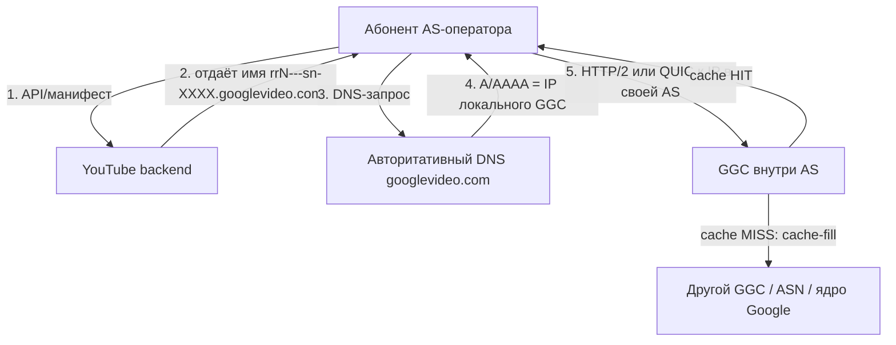

# Google Global Cache (GGC) в России

Компиляция открытых источников: как устроен GGC по официальной документации Google, как он разворачивался в РФ и в каком состоянии находится сейчас.

Состояние на **12.10.2026**.

---

## 1. Что такое GGC и как он работает (официальная модель)

GGC — это **кэш-нода Google, стоящая физически внутри сети оператора**. Google даёт железо; оператор даёт стойку, питание, клавиатуру+монитор и подключение к своей сети. Дальше Google рулит нодой удалённо ([Introduction to GGC](https://support.google.com/interconnect/answer/9058809?hl=en)).

- **Цель:** отдавать «тяжёлое» (видео, Google Play, обновления Android) изнутри AS, не гоняя через транзит/пиринг. Google заявляет **70–90% кэшируемого трафика** отдаётся из GGC; hit-rate зависит от потребления абонентов.
- **Не anycast.** Управление — через **DNS + прикладной уровень**: YouTube-бэкенд/redirector выдаёт клиенту имя кластера, в котором зашит узел (`rr1---sn-a5m7znek.googlevideo.com`), а авторитативный DNS резолвит его в unicast-IP кэша. Поэтому «какой узел тебя обслуживает» — это результат mapping'а, а не маршрутизации пакетов.



**Роль BGP — не раздача, а «карта абонентов».** Оператор поднимает eBGP-сессию с нодой (AS Google — AS15169) и **анонсирует в её сторону свои абонентские префиксы**, при желании с community-тегами: `15169:12000` = тут NAT-устройство, `15169:12100` = тут NAT'ятся пользователи ([Carrier Grade NAT](https://support.google.com/interconnect/answer/7658745?hl=en)). Google по этим анонсам строит mapping «префикс → оптимальный кластер». Набор нод, обслуживающих одних и тех же абонентов с одной политикой отказа, называется **GNL** — все ноды GNL должны получать одинаковые префиксы и теги.

**Cache-fill — иерархический CDN** ([Cache-Fill](https://support.google.com/interconnect/answer/7658593?hl=en)): кэши не предзаполняются, наполняются по спросу. Источник заливки динамически выбирается из: других GGC в твоей сети, GGC в другой AS, ядра Google (через пиринг/транзит). Есть **peer-to-peer cache-fill** — нода может тянуть с другой ноды, если её префикс проанонсирован кандидатам. Google прямо пишет: «если ACL/фильтры нарушают связность между сетями, P2P cache-fill может сломаться без явной причины».

**Как проверить свой узел самому** (эндпоинт из доки Google):

```bash
curl -4 -s "https://redirector.googlevideo.com/report_mapping?di=no"
# 85.249.22.12 => vimpelcom-iar2 (85.249.20.0/22)   ← локальный GGC, оператор+город(IATA)+кластер
# 178.62.x.x   => fra16s48 (178.62.0.0/16)          ← зарубежный edge PoP (локального кэша нет)
```

Второй способ из доки: в DevTools у `videoplayback` посмотреть `:authority:`, зарезолвить — если IP попадает в подсети ноды GGC, видео идёт из кэша. Т.е. **сравнение `report_mapping` до/после включения VPN — прямой тест, ушёл ли ты с локального кэша за границу.**

---

## 2. Как это разворачивалось в РФ

| Когда | Что произошло | Источник |
|---|---|---|
| 2017–2018 | РКН планировал ограничить GGC; операторам выписывали штрафы за его использование | [ru.wikipedia](https://ru.wikipedia.org/wiki/Google_Global_Cache) |
| май 2022 | Google начал отключать GGC-серверы в РФ | там же |
| янв 2024 | Google отказался от route servers на IX (не только в РФ) → принудительно на приватный пиринг | [Habr/Rusbase, 07.03.2025](https://habr.com/ru/news/889040/) |
| 12.07.2024 | «Ростелеком» объясняет сбои YouTube «техническими проблемами в работе GGC» | [Meduza](https://meduza.io/news/2024/08/09/kommersant-roskomnadzor-zaprosil-u-operatorov-svyazi-po-kakim-adresam-raspolagayutsya-servery-google) |
| 08.08.2024 | ГРЧЦ требует от операторов **IP-подсети и физические адреса нод GGC** | [Коммерсант/Meduza](https://meduza.io/news/2024/08/09/kommersant-roskomnadzor-zaprosil-u-operatorov-svyazi-po-kakim-adresam-raspolagayutsya-servery-google) |
| 28.08.2024 | ГРЧЦ: прекратить «искажение, фрагментацию, подмену трафика» (анти-замедление), отчёт до 02.09 | [Фонтанка/Ъ](https://www.fontanka.ru/2024/08/30/74024297/) |
| 26.12.2025 | Google уведомляет о выводе Dell R720, демонтаж с **26.01.2026** | [РБК/vc.ru](https://vc.ru/tech/2669660-google-vyvodit-ustarevshie-serveri-dell-r720) |
| 10.02.2026 | `youtube.com` пропадает из DNS **НСДИ** → полная блокировка по домену | [Moscow Times](https://ru.themoscowtimes.com/2026/02/10/roskomnadzor-pereshel-kpolnoi-blokirovke-youtube-posle-polutora-let-zamedleniya-a186865), [Habr](https://habr.com/ru/news/995016/) |

**Ключевая коллизия 2024 года.** ТСПУ стоят на внешних стыках и **не видят трафик абонент↔GGC внутри AS**. Операторы предоставляли под GGC **свои** подсети из своих AS — поэтому этих адресов нет в публичных списках префиксов Google (Ярослав Зверьков, Baikal-IX). Отсюда интерес ГРЧЦ к адресам нод: чтобы внести локальные IP в фильтрацию. По данным «Ъ», после 1 августа суточный трафик с одного сервера GGC к абонентам упал до **~30% от июля**; часть операторов фиксировала блокировку трафика именно «от GGC к абонентам». Дальше видео ушло из кэшей на магистраль/стыки — кэш перестал экономить полосу.

> Оговорка: «РКН внёс подсети GGC в списки фильтрации» и «операторы гасили BGP-анонсы к GGC» — это **выводы экспертов и источников «Ъ», не официальные подтверждения**.

---

## 3. Состояние на сейчас

- **Железо живо.** По подсчёту Gansterito (перебор кластеров `оператор-IATA` по IP, сверен с метрикой «GGC health» в кабинете `isp.google.com`): на конец 2025 — **931 живая нода** у шести крупнейших против 1140 в июле 2024 (**~81.7% выживших**), экстраполяция на всю страну — **~1160** ([Habr, 29.12.2025](https://habr.com/ru/articles/981630/)). Из строя вышло <20% за 4 года без поставок ЗИПа.
- **R720 — плановая утилизация**, а не «уход Google». Письма о выводе R720 (EOL у Dell с 2018) были ещё в июле 2025; у крупных операторов они давно заменены на R730/R740 с 100G. Новые модели не отключаются.
- **Пиринг:** Google вычистил РФ из PeeringDB и отказался от route servers, сохранив прямые приватные стыки с федералами ([Habr](https://habr.com/ru/news/889040/)).
- **Что сейчас течёт через GGC:** минимум — в основном обновления Android; крупные потребители — международные операторы, закупающие транзит в РФ (их трафик локальным «замедлениям» не подчиняется).
- **YouTube:** с декабря 2024 замедление стало фактически непроходимым (по Meduza — ~128 кбит/с TCP и ~512 кбит/с QUIC), с 10.02.2026 — блок по домену через НСДИ. Формально в реестре как «заблокирован навсегда» сервис не значится, обходится сменой DNS/VPN.
- **Ёмкость ТСПУ** (для контекста): 1207 узлов ШПД + 135 мобильных + 86 трансграничных, суммарная нагрузка ~132 Tbps ([Habr](https://habr.com/ru/news/995016/)) — отсюда и переход на дешёвый DNS-«выключатель» вместо DPI-замедления.

---

## Что не подтверждено

- Точное общее число нод GGC в РФ (1.1–1.2k — оценка, не замер).
- AS-номера GGC-пиринга кроме AS15169.
- Официальные причины снятия анонсов к GGC и внесения подсетей GGC в фильтрацию.

## Источники

**Документация Google (Interconnect Help)**
- [Introduction to GGC](https://support.google.com/interconnect/answer/9058809?hl=en)
- [Cache-Fill](https://support.google.com/interconnect/answer/7658593?hl=en)
- [Carrier Grade NAT](https://support.google.com/interconnect/answer/7658745?hl=en)

**РФ: хроника**
- [Meduza / «Коммерсант»: ГРЧЦ запросил адреса серверов Google (09.08.2024)](https://meduza.io/news/2024/08/09/kommersant-roskomnadzor-zaprosil-u-operatorov-svyazi-po-kakim-adresam-raspolagayutsya-servery-google)
- [Фонтанка / «Ъ»: РКН потребовал от операторов не ускорять YouTube (30.08.2024)](https://www.fontanka.ru/2024/08/30/74024297/)
- [Habr / Rusbase: Google отключил пиринговые соединения с IX и ЦОД в РФ (07.03.2025)](https://habr.com/ru/news/889040/)
- [РБК / vc.ru: Google вывозит устаревшие серверы Dell R720 (26.12.2025)](https://vc.ru/tech/2669660-google-vyvodit-ustarevshie-serveri-dell-r720)
- [Habr: сколько теперь серверов GGC в России (29.12.2025)](https://habr.com/ru/articles/981630/)
- [The Moscow Times: РКН перешёл к полной блокировке YouTube (10.02.2026)](https://ru.themoscowtimes.com/2026/02/10/roskomnadzor-pereshel-kpolnoi-blokirovke-youtube-posle-polutora-let-zamedleniya-a186865)
- [Habr: мощности ТСПУ для YouTube и Telegram (10.02.2026)](https://habr.com/ru/news/995016/)
- [ru.wikipedia: Google Global Cache](https://ru.wikipedia.org/wiki/Google_Global_Cache)
- [ru.wikipedia: Блокировка YouTube в России](https://ru.wikipedia.org/wiki/%D0%91%D0%BB%D0%BE%D0%BA%D0%B8%D1%80%D0%BE%D0%B2%D0%BA%D0%B0_YouTube_%D0%B2_%D0%A0%D0%BE%D1%81%D1%81%D0%B8%D0%B8)
