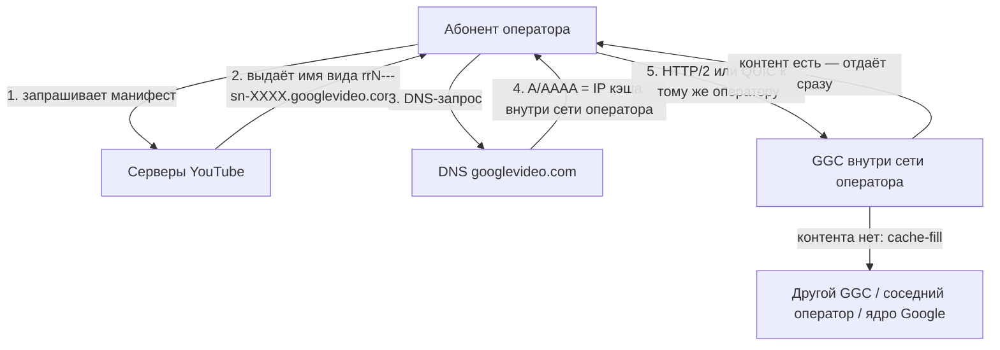

# Google Global Cache в России

**Коротко.** Google раздаёт операторам связи серверы-кэши и ставит их прямо внутрь сети оператора — чтобы видео и другой «тяжёлый» контент не уходил в магистраль. В России эта программа работала с начала 2010-х; к июлю 2024 года у шести крупнейших операторов стояло больше тысячи таких серверов, а к концу 2025-го осталось около 930 живых. При этом с 2024 года трафик YouTube через локальные кэши почти перестал ходить — не из-за физической поломки «железа», а из-за фильтрации ТСПУ и динамики балансировки самого Google.

Ниже — как GGC устроен технически, как проверить свой узел, хроника событий в РФ, реальные инсайды и наблюдения сетевых инженеров с профильного форума ntc.party, а также подробный технический FAQ по типовым проблемам, ошибкам и их решениям.

*Обзор составлен по официальной документации и открытым источникам (ссылки в конце). Состояние на октябрь 2026 года.*

---

## Что такое GGC

Google Global Cache — это кэширующие серверы Google, которые стоят не в дата-центрах компании, а **внутри сети интернет-провайдера**. Google привозит железо, а оператор даёт стойку, питание, охлаждение, клавиатуру с монитором и подключение к своей сети. Дальше Google управляет серверами удалённо ([Introduction to GGC](https://support.google.com/interconnect/answer/9058809?hl=en)).

Смысл простой: если популярное видео уже скачал другой абонент этого же оператора, второму оно отдаётся не из-за границы, а с сервера в соседнем зале. Оператор экономит на транзите, абонент получает видео быстрее. По оценке Google, **70–90% кэшируемого трафика** отдаётся именно так; точная доля зависит от того, что смотрят абоненты конкретной сети.

Через GGC идёт не только YouTube, но и Google Play, обновления Android, картинки поиска, шрифты и прочая статика.

---

## Как запрос попадает на локальный кэш

Важно понимать: GGC — **не anycast**. Никакой «ближайший маршрут» пакетов тут не работает. Google управляет раздачей на уровне приложения и DNS: серверы YouTube сами решают, на какой узел отправить клиента, и выдают ему имя этого узла, а DNS просто резолвит это имя в обычный IP-адрес.



**Зачем тогда BGP?** Он нужен не для раздачи, а чтобы Google знал, какие адреса принадлежат какому оператору. Оператор поднимает BGP-сессию с узлом Google и **анонсирует в его сторону свои абонентские подсети** — так Google строит карту «этот префикс обслуживает такой-то кластер». При желании анонсы помечают тегами: `15169:12000` означает «здесь стоит NAT», `15169:12100` — «здесь за NAT пользователи» ([Carrier Grade NAT](https://support.google.com/interconnect/answer/7658745?hl=en)). Набор узлов, которые обслуживают одних и тех же абонентов с одинаковой политикой отказа, Google называет **GNL** (GGC Network Location) — у всех узлов одного GNL должны быть одинаковые анонсы и теги.

**Наполнение кэша (cache-fill)** — иерархическое ([Cache-Fill](https://support.google.com/interconnect/answer/7658593?hl=en)). Кэши никто заранее не заполняет: сервер скачивает контент по мере спроса. Источник заливки Google выбирает динамически — это может быть другой кэш в сети того же оператора, кэш у соседнего оператора или ядро Google. Есть и peer-to-peer заливка: один GGC тянет контент с другого, если тот проанонсировал свой префикс. Здесь есть тонкость, критически важная для работы в РФ: в документации Google прямо сказано, что если фильтры или ACL нарушают связность между сетями, peer-to-peer cache-fill может ломаться без очевидных внешних причин.

---

## Как проверить, откуда у вас приходит видео

Google держит для этого служебную страницу. Достаточно открыть её в браузере (или через `curl`):

```bash
curl -4 -s "https://redirector.googlevideo.com/report_mapping?di=no"
```

Ответ выглядит так:

```text
85.249.22.12 => vimpelcom-iar2 (85.249.20.0/22)
```

Слева — ваш внешний IP, справа — кластер, который вам назначен. Имя кластера собирается по шаблону `оператор-IATA+номер`:

- `vimpelcom` — оператор в терминах Google (у МТС это `comstar`, у «Ростелекома» — `rostelecom`, у «МегаФона» — `megafon`, у ТТК — `transtelecom`, у «Дом.ру» — `ertelecom`);
- `iar` — IATA-код ближайшего аэропорта (`iar` — Ярославль, `svo`/`dme`/`vko` — Москва, `led` — Санкт-Петербург, `goj` — Нижний Новгород, `skx` — Саранск, `ovb` — Новосибирск);
- `2` — номер кластера в этой локации.

Если в ответе стоит зарубежный код — например, `arn09s18` (Стокгольм), `fra16s48` (Франкфурт), `ams` (Амстердам) или `hel` (Хельсинки), — значит локального кэша сейчас нет и видео перенаправлено на внешние дата-центры Google. Сравнение ответа до и после включения VPN — прямой тест, ушли ли вы с локального кэша за границу.

Второй способ — посмотреть реальные соединения в браузере (F12 → Network). Найдите запрос к `videoplayback`, посмотрите его заголовок `:authority:` (например, `r2---sn-5uaezn6k.googlevideo.com`) и реальный Remote IP. Пинг до этого адреса (RTT 15–30 мс) однозначно показывает, находится ли сервер физически в РФ, даже если базы Whois/2ip ошибочно приписывают адреса Google к США или Ирландии.

---

## GGC в России: как всё начиналось

Программа развивалась с начала 2010-х. К 2012 году крупные операторы уже выстроили с Google системное взаимодействие: логистику, поддержку, гарантийную замену железа. Размещение шло по одной из трёх схем (их описывал инженер оператора связи в [разборе на Habr](https://habr.com/ru/articles/828762/)):

1. Google присылает только серверы, BGP-сессия поднимается с приватной AS 65535.
2. То же самое, но BGP-сессия с AS 11344.
3. Google присылает серверы **и** маршрутизатор, BGP-сессия — с AS 36040, а подсеть под серверы прописывается статикой.

Адресный план у всех схем одинаковый: адреса на физические серверы и отдельные виртуальные адреса (`r1`, `r2`, …), на которых работает HTTPS. Зная IP виртуального адреса, с помощью ping со смещением вычисляется количество реальных железных серверов в кластере (их в одной стойке не больше восьми).

К июлю 2024 года по этой методике насчитали **1140 серверов** у шести крупнейших операторов:

| Оператор | Серверов | Городов |
|---|---:|---:|
| Ростелеком | 348 | 54 |
| ВымпелКом (билайн) | 214 | 42 |
| МТС | 176 | 15 |
| МегаФон + НетБайНет | 147 | 22 |
| ЭрТелеком (Дом.ру) | 133 | 34 |
| Транстелеком | 122 | 27 |

Метод даёт нижнюю оценку: у операторов «второго эшелона» серверы тоже есть (+20–25% к найденному), плюс стойки самого Google на точках обмена в Москве и Петербурге. Суммарно по РФ было порядка 1400–1500 серверов.

Давление регулятора началось задолго до 2024 года: в 2017-м Роскомнадзор публично обсуждал планы ограничить GGC, а в 2018-м выставлялись штрафы за использование несертифицированных комплексов ([ru.wikipedia](https://ru.wikipedia.org/wiki/Google_Global_Cache)). В мае 2022 года Google прекратил поставки нового оборудования после банкротства российского юрлица ООО «Гугл».

---

## 2024: почему «деградация GGC» стала официальной версией

Летом 2024 года YouTube в России подвергся резкому замедлению:

* **Официальная версия:** «деградация серверов GGC» из-за отсутствия обновлений и износа дисков (заявление «Ростелекома» от 12 июля 2024 года, поддержанное РКН и Госдумой).
* **Техническая реальность:** искусственное замедление через комплексы ТСПУ (технические средства противодействия угрозам, установленные у операторов по закону о «суверенном Рунете»). Доказательство: модификация пакетов через *zapret*, *GoodbyeDPI* или *ByeDPI* мгновенно возвращала скорость 4K.

### Коллизия локальных кэшей и ТСПУ

ТСПУ исторически ставятся на **внешних стыках** (аплинки, пиринги, стыки IX). Трафик абонента к локальному GGC внутри сети провайдера идёт напрямую (intra-AS) и **не проходит через внешние коробки ТСПУ**. 

Поскольку провайдеры выделяли под GGC IP-адреса из пулов собственных автономных систем (AS), этих адресов не было в публичных реестрах подсетей Google (как пояснял основатель Baikal-IX Ярослав Зверьков). Поэтому локальный трафик продолжал идти на полной скорости, пока магистральный резался.

Хроника реакции регулятора:

| Дата | Что произошло |
|---|---|
| 08.08.2024 | Главный радиочастотный центр (ГРЧЦ) потребовал от операторов предоставить IP-подсети и физические адреса размещения серверов GGC ([«Коммерсант»](https://meduza.io/news/2024/08/09/kommersant-roskomnadzor-zaprosil-u-operatorov-svyazi-po-kakim-adresam-raspolagayutsya-servery-google)) |
| 28.08.2024 | ГРЧЦ направил операторам жесткое предписание прекратить применение любых технологий обхода (фрагментация TCP, подмена SNI) под угрозой аннулирования лицензий ([«Фонтанка»](https://www.fontanka.ru/2024/08/30/74024297/)) |

После внесения локальных подсетей кэшей в политики фильтрации суточный трафик от серверов GGC к абонентам упал до **~30% от июльского**. Трафик принудительно выдавили на внешние стыки.

---

## Что выяснили сетевые инженеры на ntc.party

На профильном форуме по исследованию цензуры [ntc.party](https://ntc.party) собрана детальная картина поведения GGC:

### 1. Реальный текст письма Google об утилизации Dell R720
В теме [#21549](https://ntc.party/t/google-%D0%B7%D0%B0%D0%B1%D0%BB%D0%BE%D0%BA%D0%B8%D1%80%D1%83%D0%B5%D1%82-%D1%8E%D1%82%D1%83%D0%B1-%D0%B2-%D1%80%D1%84/21549) опубликован текст официального письма от **Google Edge Operations** операторам связи от конца декабря 2025 года:
> *«Мы будем выводить из эксплуатации машины Dell R720, размещенные в вашей инфраструктуре. Эти машины сняты с производства (EOL) и не имеют гарантийного срока. Все остальные машины Google Global Cache (GGC), размещенные в вашей сети, останутся в эксплуатации. Узлы Dell R720 обрабатывают минимальный трафик, и замена на данный момент не требуется... Начнем вывод 26 января 2026 года»*.

Это прямо подтверждает: речь шла о плановом выводе старых машин линейки 2012 года, а не о закрытии всей сети GGC.

### 2. Инсайд о замене стоек GGC на отечественные кэши
В теме [#25962](https://ntc.party/t/ggc-%D0%BD%D0%B0-%D1%80%D0%BE%D1%81%D1%82%D0%B5%D0%BB%D0%B5%D0%BA%D0%BE%D0%BC/25962) инженер небольшого оператора рассказал, что из-за падения входящего трафика YouTube кэш-серверы Google занимали драгоценные стойко-места впустую:
> *«Траф на GGC упал до 2 гигабайт, и его решили отключить, поставив стойку от Yadro с кэшем Rutube, VK и т.д.»*

### 3. Динамика осени 2026 года: уход за рубеж и возврат кэшей
* В августе–сентябре 2026 года абоненты «Ростелекома» массово отмечали, что эндпоинт `report_mapping` выдавал исключительно серверы во Франкфурте, Стокгольме и Амстердаме. Принудительное заворачивание на локальные IP через DNS-rewrite резалось до 30–40 КБ/с.
* **11 октября 2026 года** участники зафиксировали внезапный возврат: YouTube снова стал маршрутизировать абонентов Ростелекома в МО на `rostelecom-svo13`, в Поволжье — на `rostelecom-goj4` (Нижний Новгород) и `rostelecom-skx1` (Саранск), а по IPv6 — на московский узел Google (`svo07s01-in-f21.1e100.net`, пинг 22 мс). Балансировка Google динамически перенаправляет клиентов на внешние и внутренние площадки в зависимости от телеметрии доступности.

---

## Состояние на конец 2026 года

1. **Серверы живы:** На декабрь 2025 года насчитывалось **931 активная нода** у шести крупнейших операторов (около 82% от уровня 2024 года), экстраполяция на всю страну — **~1160 серверов** ([Habr](https://habr.com/ru/articles/981630/)). За 4 года без официального ЗИПа вышло из строя менее 20% парка. Более новые модели Dell R730 и R740 со 100G-портами продолжают стоять в стойках.
2. **Пиринг урезан:** Google убрал российские узлы из базы PeeringDB, отказался от route servers на IX и перешёл на приватный пиринг (PNI) с федеральными операторами ([Habr / Rusbase](https://habr.com/ru/news/889040/)).
3. **Что реально обслуживает GGC:** Обновления Android, компоненты Google Play, веб-шрифты и поиск. Крупные потребители оставшихся российских GGC — провайдеры из Казахстана, Узбекистана и Кыргызстана, покупающие транзит у операторов РФ: их трафик локальным фильтрам РКН не подчиняется.
4. **YouTube и НСДИ:** 10 февраля 2026 года домен `youtube.com` был исключён из ответов DNS Национальной системы доменных имён (НСДИ) ([The Moscow Times](https://ru.themoscowtimes.com/2026/02/10/roskomnadzor-pereshel-kpolnoi-blokirovke-youtube-posle-polutora-let-zamedleniya-a186865), [Habr](https://habr.com/ru/news/995016/)). Эксперты объяснили это разгрузкой ТСПУ: одновременный сложный DPI-анализ терабитов трафика YouTube и начавшееся замедление Telegram перегружали оборудование (суммарная проектная нагрузка ТСПУ достигла 132 Тбит/с на 1207 узлах ШПД и 135 узлах мобильной связи).

---

## FAQ: проблемы с GGC, объяснения и решения

Здесь собраны реальные технические проблемы, симптомы, ошибки и их решения, разобранные сетевыми инженерами на форуме ntc.party:

### В: Ролик стартует на полной скорости, но зависает на 19–30 секунде. В чём причина?
**О:** Это классический эффект **Cache Miss (промаха кэша)**:
1. Плеер запрашивает стартовый чанк видео. Если стартовые секунды уже есть на локальном кэше провайдера или выдаются с быстрого буфера, видео начинает играть сразу.
2. Если ролика целиком на локальном GGC нет, кэш обязан запросить фоновую подгрузку (cache-fill) с центральных серверов Google. Однако магистральные каналы между российским GGC и внешними ЦОД Google зажаты фильтрами ТСПУ — заливка падает по таймауту.
3. Плеер понимает, что локальный узел заглох, и экстренно переключается на внешний резервный сервер Google (например, в США или Нидерландах с IP `74.125.x.x`). Там поток немедленно натыкается на шейпинг ТСПУ (до 128 кбит/с) или обрывается по TCP RST.

**Решение:**
* Если используется проксирование/VPN: настроить split-tunneling так, чтобы домен `*.googlevideo.com` уходил в туннель целиком. Когда и манифест, и видеопотоки тянутся через зарубежный узел, Google выдает близкие к VPN европейские кэши без участия локальных сбоящих узлов.
* Если используются утилиты обхода DPI (*zapret* / *ByeDPI*): убедиться, что стратегия дурения ТСПУ применяется не только к общему домену `youtube.com`, но и к маске `*.googlevideo.com` (включая порты TCP 443 и UDP 443 для QUIC).

---

### В: Ошибки «HTTP 403 Forbidden» в консоли браузера на запросах к `videoplayback`. Почему Google отдаёт 403?
**О (темы [#14070](https://ntc.party/t/%D0%B1%D0%B0%D0%BD-%D0%BE%D1%82-google-403-%D0%BE%D1%88%D0%B8%D0%B1%D0%BA%D0%B8-%D0%BF%D0%BB%D0%B5%D0%B5%D1%80%D0%B0-%D0%BD%D0%B5-%D1%80%D0%B0%D0%B1%D0%BE%D1%82%D0%B0%D0%B5%D1%82-youtube-%D1%81%D0%BE-%D0%B2%D1%81%D0%B5%D0%BC%D0%B8-%D1%81%D1%82%D1%80%D0%B0%D1%82%D0%B5%D0%B3%D0%B8%D1%8F%D0%BC%D0%B8-zapret/14070), [#10330](https://ntc.party/t/%D0%B3%D1%80%D1%83%D0%B7%D0%B8%D1%82%D1%81%D1%8F-%D1%82%D0%BE%D0%BB%D1%8C%D0%BA%D0%BE-%D1%87%D0%B0%D1%81%D1%82%D1%8C-%D0%B2%D0%B8%D0%B4%D0%B5%D0%BE-%D0%BD%D0%B0-youtube-403-forbidden/10330)):**
URL каждого видеочанка подписывается криптографическим токеном YouTube, в который жёстко вшит исходный IP-адрес клиента (параметр `&ip=x.x.x.x` в запросе):
1. **Несогласованный split-tunneling (IP-mismatch):** Если веб-страница (`youtube.com`) загружается через VPN/прокси, а сам медиапоток `googlevideo.com` идёт напрямую от российского провайдера (или наоборот), GGC видит несоответствие: токен выписан на европейский IP прокси, а за чанком пришёл российский IP абонента. Сервер мгновенно сбрасывает сессию с кодом `403 Forbidden`.
2. **Агрессивный desync TCP:** Некоторые комбинации фейковых пакетов или завышенный размер окна (`--wwsize`) приводят к повреждению HTTP-заголовков на стороне сервера Google.

**Решение:**
* Не разрывать домены `youtube.com` и `googlevideo.com` между разными сетевыми интерфейсами (выходной IP для API и видеопотока должен строго совпадать).
* Очистить кэш браузера / сессионные куки и убедиться в отсутствии дублирующих прокси-расширений.

---

### В: Подмена геотаргетинга: почему при работе через европейский VPS/VPN видео отправляется на российские GGC?
**О (тема [#9111](https://ntc.party/t/google-%D0%BD%D0%B0%D1%87%D0%B0%D0%BB-%D0%B2%D0%BD%D0%BE%D1%81%D0%B8%D1%82%D1%8C-ip-proxy-%D1%81%D0%B5%D1%80%D0%B2%D0%B5%D1%80%D0%BE%D0%B2-%D0%B2-%D1%81%D0%BF%D0%B8%D1%81%D0%BE%D0%BA-%D0%B0%D0%B4%D1%80%D0%B5%D1%81%D0%BE%D0%B2-%D1%80%D1%84-%D0%B3%D0%B5%D0%BE%D1%82%D0%B0%D1%80%D0%B3%D0%B5%D1%82%D0%B8%D0%BD%D0%B3/9111)):**
Алгоритмы геолокации Google анализируют совокупность факторов:
1. Если через один и тот же недорогой хостинг (Hetzner, OVH, DigitalOcean в Нидерландах/Германии) тысячи пользователей из РФ круглосуточно смотрят русскоязычный контент с активными Google-аккаунтами и часовым поясом MSK, Google относит IP-подсеть этого VPS к «региону Россия».
2. В результате бэкенд начинает выдавать европейскому VPS манифесты со ссылками на российские GGC (`rostelecom-*`, `megafon-*`). Но российские кэши физически не обслуживают внешние зарубежные BGP-анонсы — соединение зависает по таймауту.

**Решение:**
* Использовать цепочку с выходным туннелем через Cloudflare WARP на самом сервере (warp-routing отправляет запрос в правильный локальный egress-пул).
* На клиенте в правилах маршрутизации Xray/Sing-box отправлять запросы к DNS Google через резолверы целевой страны (без передачи EDNS Client Subnet абонента).

---

### В: Задержка 6–10 секунд перед стартом каждого ролика (чёрный экран и спиннер). Что происходит?
**О (тема [#8395](https://ntc.party/t/%D0%B7%D0%B0%D0%B4%D0%B5%D1%80%D0%B6%D0%BA%D0%B0-%D0%BF%D0%B5%D1%80%D0%B5%D0%B4-%D0%B7%D0%B0%D0%BF%D1%83%D1%81%D0%BA%D0%BE%D0%BC-%D0%B2%D0%B8%D0%B4%D0%B5%D0%BE-youtube-6-10-%D1%81%D0%B5%D0%BA%D1%83%D0%BD%D0%B4/8395)):**
Браузер отправляет параллельные TCP SYN / QUIC Initial к основному назначенному кэшу провайдера. Если этот кэш подвергнут фильтрации ТСПУ и пакеты молча отбрасываются (Drop / Blackhole), встроенный плеер ожидает ответа ровно системный TCP/QUIC-таймаут (5–10 секунд). Только после таймаута плеер перебирает резервные хосты из манифеста и начинает показ.

**Решение:**
* Если найден конкретный «мёртвый» кластер провайдера, можно заблокировать к нему доступ на уровне клиента (в файле `hosts` направить проблемный хост `rr*---sn-*.googlevideo.com` на `0.0.0.0`, либо заблокировать правило в uBlock Origin: `||rr*---sn-*.googlevideo.com^$badfilter`). При мгновенном отказе соединения браузер переключится на рабочий узел за миллисекунды без ожидания таймаута.

---

### В: Почему консольная утилита `yt-dlp` отказывается скачивать видео, когда в браузере всё открывается?
**О (тема [#11597](https://ntc.party/t/yt-dlp-%D0%BE%D0%BF%D1%8F%D1%82%D1%8C-%D0%BD%D0%B5-%D0%BA%D0%B0%D1%87%D0%B0%D0%B5%D1%82-%D0%B2%D0%B8%D0%B4%D0%B5%D0%BE-%D1%81-%D1%8E%D1%82%D1%83%D0%B1%D0%B0/11597)):**
1. Современный веб-плеер YouTube в браузере при первых сбоях агрессивно пробует пул из 3–5 альтернативных адресов.
2. Консольная утилита `yt-dlp` по умолчанию выбирает один основной URL потока из манифеста (чаще всего ближайший локальный GGC) и упорно повторяет ретраи к нему. Если этот конкретный узел режется ТСПУ, загрузка падает с ошибкой `Read timed out` или `HTTPSConnectionPool`.

**Решение:**
* В параметрах *zapret* для списка с `googlevideo.com` скорректировать TTL под локальный узел (например, жестко задать `--dpi-desync-ttl=4` вместо `autottl`).
* В `yt-dlp` передавать флаги работы через локальный прокси (`--proxy socks5://127.0.0.1:...`) либо использовать экстрактор с альтернативными форматами потока.

---

### В: Почему `redirector.googlevideo.com` показывает зарубежный узел (FRA, AMS, ARN), а пинг низкий?
**О:** Ошибки баз геолокации (GeoIP / Whois). 
Многие глобальные подсети Google (например, `2a00:1450:4011::` или `173.194.x.x`) юридически зарегистрированы на головные структуры в США или Ирландии. Сервисы вроде 2ip или MaxMind GeoLite показывают страну регистрации владельца подсети.
Реальным критерием физической дистанции является RTT (Round Trip Time):
* Пинг **15–25 мс** из ЦФО однозначно доказывает, что сервер физически находится в Москве (например, узел MSK-IX / Шереметьево `svo07s01`).
* Пинг **45–70 мс** — северная или центральная Европа (Стокгольм, Хельсинки, Франкфурт).
* Пинг **>110 мс** — реальные трансокеанские площадки в США.

---

### В: Почему одни стратегии *zapret* работают для одного видео, но ломаются на другом?
**О:** YouTube использует распределённый пул из десятков тысяч кластеров GGC. Разные видеоролики (или даже разные качества одного ролика) отдаются с разных серверов (`rr1---sn-*.googlevideo.com`).
* Локальные провайдерские узлы могут обрабатываться ТСПУ мягче или требовать одних параметров десинхронизации (например, `-e 1` или `split2`).
* Дальние зарубежные GGC при откате могут требовать других смещений или блокироваться по протоколу QUIC.

**Решение:**
Подбирать стратегию через утилиту `blockcheck` (из состава *zapret*) не на абстрактном домене, а на 3–5 реальных хостах GGC, выписанных из консоли F12 браузера при воспроизведении проблемных видео.

---

### В: Ломается ли загрузка приложений и обновлений в Google Play?
**О:** Периодически да. В отличие от браузерного YouTube, клиент Google Play на Android не умеет гибко перебирать десятки резервных CDN-зеркал: он жёстко обращается к назначенному локальному кэшу провайдера. Если локальный узел испытывает проблемы со связностью или попадает под веерные сбросы ТСПУ, скачивание тяжелых APK/OBB зависает на 0% или выдаёт ошибку загрузки.

**Решение:**
Временное переключение на альтернативный DNS (DoH/DoT) в настройках роутера или Android («Частный DNS-сервер»), либо использование VPN для старта загрузки приложения.

---

### В: Что делать, если включение TLS 1.3 Kyber ломает работу GGC?
**О:** Алгоритм постквантового шифрования Kyber (ML-KEM) увеличивает пакет `ClientHello` до 2–3 КБ, из-за чего он фрагментируется на уровне IP или сдвигает поле SNI за пределы типового буфера инспекции DPI. На некоторых старых прошивках маршрутизаторов и серверов GGC это вызывало сброс соединения.

**Решение:**
В браузерах на базе Chromium можно временно отключить флаг `chrome://flags/#enable-tls13-kyber`, либо в конфигурации *zapret* скорректировать параметры фрагментации пакетов с учётом возросшего размера заголовка.

---

## Чего мы не знаем

- **Точное число серверов:** 930–1160 — это расчётная оценка по пингам известных кластеров, а не закрытая статистика операторов.
- **Состояние накопителей:** Узел может отвечать на ICMP и BGP, но при выпадении части дисков иметь сниженную дисковую производительность.
- **Алгоритмы переключения Google:** Полная логика того, в какие моменты YouTube переключает российский префикс на внешние серверы (Франкфурт, Стокгольм) и когда возвращает обратно на локальные узлы.

---

## Источники

**Официальная документация Google (Interconnect Help)**
- [Introduction to GGC](https://support.google.com/interconnect/answer/9058809?hl=en)
- [Cache-Fill](https://support.google.com/interconnect/answer/7658593?hl=en)
- [Carrier Grade NAT](https://support.google.com/interconnect/answer/7658745?hl=en)

**Анализ инфраструктуры и обсуждения на ntc.party**
- [ntc.party: GGC на Ростелеком (Topic #25962)](https://ntc.party/t/ggc-%D0%BD%D0%B0-%D1%80%D0%BE%D1%81%D1%82%D0%B5%D0%BB%D0%B5%D0%BA%D0%BE%D0%BC/25962)
- [ntc.party: Google заблокирует ютуб в РФ — текст письма о Dell R720 (Topic #21549)](https://ntc.party/t/google-%D0%B7%D0%B0%D0%B1%D0%BB%D0%BE%D0%BA%D0%B8%D1%80%D1%83%D0%B5%D1%82-%D1%8E%D1%82%D1%83%D0%B1-%D0%B2-%D1%80%D1%84/21549)
- [ntc.party: Бан от Google 403 / Ошибки плеера (Topic #14070)](https://ntc.party/t/%D0%B1%D0%B0%D0%BD-%D0%BE%D1%82-google-403-%D0%BE%D1%88%D0%B8%D0%B1%D0%BA%D0%B8-%D0%BF%D0%BB%D0%B5%D0%B5%D1%80%D0%B0-%D0%BD%D0%B5-%D1%80%D0%B0%D0%B1%D0%BE%D1%82%D0%B0%D0%B5%D1%82-youtube-%D1%81%D0%BE-%D0%B2%D1%81%D0%B5%D0%BC%D0%B8-%D1%81%D1%82%D1%80%D0%B0%D1%82%D0%B5%D0%B3%D0%B8%D1%8F%D0%BC%D0%B8-zapret/14070)
- [ntc.party: Google вносит IP Proxy серверов в геотаргетинг РФ (Topic #9111)](https://ntc.party/t/google-%D0%BD%D0%B0%D1%87%D0%B0%D0%BB-%D0%B2%D0%BD%D0%BE%D1%81%D0%B8%D1%82%D1%8C-ip-proxy-%D1%81%D0%B5%D1%80%D0%B2%D0%B5%D1%80%D0%BE%D0%B2-%D0%B2-%D1%81%D0%BF%D0%B8%D1%81%D0%BE%D0%BA-%D0%B0%D0%B4%D1%80%D0%B5%D1%81%D0%BE%D0%B2-%D1%80%D1%84-%D0%B3%D0%B5%D0%BE%D1%82%D0%B0%D1%80%D0%B3%D0%B5%D1%82%D0%B8%D0%BD%D0%B3/9111)
- [ntc.party: Задержка перед запуском видео 6-10 секунд (Topic #8395)](https://ntc.party/t/%D0%B7%D0%B0%D0%B4%D0%B5%D1%80%D0%B6%D0%BA%D0%B0-%D0%BF%D0%B5%D1%80%D0%B5%D0%B4-%D0%B7%D0%B0%D0%BF%D1%83%D1%81%D0%BA%D0%BE%D0%BC-%D0%B2%D0%B8%D0%B4%D0%B5%D0%BE-youtube-6-10-%D1%81%D0%B5%D0%BA%D1%83%D0%BD%D0%B4/8395)
- [ntc.party: Yt-dlp опять не качает видео с ютуба (Topic #11597)](https://ntc.party/t/yt-dlp-%D0%BE%D0%BF%D1%8F%D1%82%D1%8C-%D0%BD%D0%B5-%D0%BA%D0%B0%D1%87%D0%B0%D0%B5%D1%82-%D0%B2%D0%B8%D0%B4%D0%B5%D0%BE-%D1%81-%D1%8E%D1%82%D1%83%D0%B1%D0%B0/11597)
- [ntc.party: Подбор рабочего конфига для GGC ютуба через blockcheck (Topic #10060)](https://ntc.party/t/%D0%BF%D0%BE%D0%B4%D0%B1%D0%BE%D1%80-%D1%80%D0%B0%D0%B1%D0%BE%D1%87%D0%B5%D0%B3%D0%BE-%D0%BA%D0%BE%D0%BD%D1%84%D0%B8%D0%B3%D0%B0-%D0%B4%D0%BB%D1%8F-ggc-%D1%8E%D1%82%D1%83%D0%B1%D0%B0-%D1%87%D0%B5%D1%80%D0%B5%D0%B7-blockcheck/10060)

**Хроника и регуляторные решения**
- [Habr: сколько всего серверов GGC в России (15.07.2024)](https://habr.com/ru/articles/828762/)
- [Habr: сколько теперь серверов GGC в России (29.12.2025)](https://habr.com/ru/articles/981630/)
- [«Коммерсант» / Meduza: ГРЧЦ запросил адреса серверов Google (09.08.2024)](https://meduza.io/news/2024/08/09/kommersant-roskomnadzor-zaprosil-u-operatorov-svyazi-po-kakim-adresam-raspolagayutsya-servery-google)
- [«Фонтанка» / «Коммерсант»: РКН потребовал от операторов не ускорять YouTube (30.08.2024)](https://www.fontanka.ru/2024/08/30/74024297/)
- [Habr / Rusbase: Google отключил пиринговые соединения с IX и ЦОД в России (07.03.2025)](https://habr.com/ru/news/889040/)
- [РБК / vc.ru: Google вывозит устаревшие серверы Dell R720 (26.12.2025)](https://vc.ru/tech/2669660-google-vyvodit-ustarevshie-serveri-dell-r720)
- [The Moscow Times: РКН перешёл к полной блокировке YouTube (10.02.2026)](https://ru.themoscowtimes.com/2026/02/10/roskomnadzor-pereshel-kpolnoi-blokirovke-youtube-posle-polutora-let-zamedleniya-a186865)
- [Habr: мощностей ТСПУ может не хватать для YouTube и Telegram (10.02.2026)](https://habr.com/ru/news/995016/)
- [Википедия: Google Global Cache](https://ru.wikipedia.org/wiki/Google_Global_Cache)
- [Википедия: Блокировка YouTube в России](https://ru.wikipedia.org/wiki/%D0%91%D0%BB%D0%BE%D0%BA%D0%B8%D1%80%D0%BE%D0%B2%D0%BA%D0%B0_YouTube_%D0%B2_%D0%A0%D0%BE%D1%81%D1%81%D0%B8%D0%B8)
