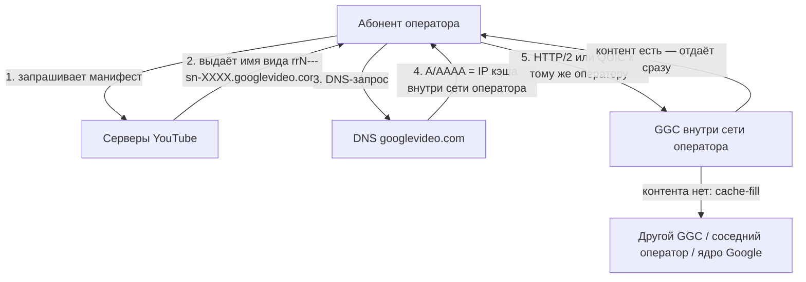

# Google Global Cache в России

**Коротко.** Google раздаёт операторам связи серверы-кэши и ставит их прямо внутрь сети оператора — чтобы видео и другой «тяжёлый» контент не уходил в магистраль. В России эта программа работала с начала 2010-х; к июлю 2024 года у шести крупнейших операторов стояло больше тысячи таких серверов, а к концу 2025-го осталось около 930 живых. При этом с 2024 года трафик YouTube через локальные кэши почти перестал ходить — но не потому, что железо сломалось.

Ниже — как GGC устроен, как проверить свой узел и что известно про российскую часть программы.

*Обзор составлен по открытым источникам (ссылки в конце). Состояние на 12 октября 2026 года.*

---

## Что такое GGC

Google Global Cache — это кэширующие серверы Google, которые стоят не в дата-центрах компании, а **внутри сети интернет-провайдера**. Google привозит железо, а оператор даёт стойку, питание, охлаждение, клавиатуру с монитором и подключение к своей сети. Дальше Google управляет серверами удалённо ([Introduction to GGC](https://support.google.com/interconnect/answer/9058809?hl=en)).

Смысл простой: если популярное видео уже скачал другой абонент этого же оператора, второму оно отдаётся не из-за границы, а с сервера в соседнем зале. Оператор экономит на транзите, абонент получает видео быстрее. По оценке Google, **70–90% кэшируемого трафика** отдаётся именно так; точная доля зависит от того, что смотрят абоненты конкретной сети.

Через GGC идёт не только YouTube, но и Google Play, обновления Android, картинки поиска, шрифты и прочая статика.

## Как запрос попадает на локальный кэш

Важно понимать: GGC — **не anycast**. Никакой «ближайший маршрут» пакетов тут не работает. Google управляет раздачей на уровне приложения и DNS: серверы YouTube сами решают, на какой узел отправить клиента, и выдают ему имя этого узла, а DNS просто резолвит это имя в обычный IP-адрес.



**Зачем тогда BGP?** Он нужен не для раздачи, а чтобы Google знал, какие адреса принадлежат какому оператору. Оператор поднимает BGP-сессию с узлом Google и **анонсирует в его сторону свои абонентские подсети** — так Google строит карту «этот префикс обслуживает такой-то кластер». При желании анонсы помечают тегами: `15169:12000` означает «здесь стоит NAT», `15169:12100` — «здесь за NAT пользователи» ([Carrier Grade NAT](https://support.google.com/interconnect/answer/7658745?hl=en)). Набор узлов, которые обслуживают одних и тех же абонентов с одинаковой политикой отказа, Google называет **GNL** (GGC Network Location) — у всех узлов одного GNL должны быть одинаковые анонсы и теги.

**Наполнение кэша (cache-fill)** — иерархическое ([Cache-Fill](https://support.google.com/interconnect/answer/7658593?hl=en)). Кэши никто заранее не заполняет: сервер скачивает контент по мере спроса. Источник заливки Google выбирает динамически — это может быть другой кэш в сети того же оператора, кэш у соседнего оператора или ядро Google. Есть и peer-to-peer заливка: один GGC тянет контент с другого, если тот проанонсировал свой префикс. Здесь есть тонкость, важная для России: в документации Google прямо написано, что если фильтры или ACL нарушают связность между сетями, peer-to-peer cache-fill может перестать работать без явной причины.

## Как проверить, откуда у вас приходит видео

Google держит для этого служебную страницу. Достаточно открыть её в браузере (или через `curl`):

```bash
curl -4 -s "https://redirector.googlevideo.com/report_mapping?di=no"
```

Ответ выглядит так:

```text
85.249.22.12 => vimpelcom-iar2 (85.249.20.0/22)
```

Слева — ваш внешний IP, справа — кластер, который вам назначили. Имя кластера собирается по шаблону `оператор-IATA+номер`:

- `vimpelcom` — оператор в терминах Google (у МТС это `comstar`, у «Ростелекома» — `rostelecom`);
- `iar` — IATA-код ближайшего аэропорта (Ярославль);
- `2` — номер кластера: в одной локации у оператора может быть несколько кластеров.

Если в ответе стоит зарубежный код — например, `arn09s18` (Стокгольм) или `fra16s48` (Франкфурт), — значит локального кэша у вас нет и видео идёт из дата-центра Google за границей. Это и есть простой способ проверить, работает ли кэш вашего оператора: сравните ответ до и после включения VPN.

Второй способ — посмотреть в браузере, с какого хоста качается видео. В инструментах разработчика на вкладке Network найдите запрос `videoplayback`, посмотрите его `:authority:` (там будет что-то вроде `r2---sn-5uaezn6k.googlevideo.com`) и зарезолвьте это имя: если адрес попадает в подсеть кэша, видео идёт из локального узла.

## GGC в России: как всё начиналось

Программа развивалась с начала 2010-х. К 2012 году крупные операторы уже выстроили с Google системную работу: логистику, поддержку, гарантийную замену железа. Размещение шло по одной из трёх схем (их описывает инженер оператора связи в [разборе на Habr](https://habr.com/ru/articles/828762/)):

1. Google присылает только серверы, BGP-сессия поднимается с приватной AS 65535. Схема давно не используется.
2. То же самое, но BGP-сессия с AS 11344.
3. Google присылает серверы **и** маршрутизатор, BGP-сессия — с AS 36040, а подсеть под серверы прописывается статикой.

Адресный план у всех схем одинаковый: несколько адресов на физические серверы и отдельные виртуальные адреса (`r1`, `r2`, …), на которых работает HTTPS. На этом построен публичный метод подсчёта серверов — по IP виртуального адреса и смещениям вниз находят адреса физических машин (в кластере их не больше восьми).

К июлю 2024 года по этой методике насчитали **1140 серверов** у шести крупнейших операторов:

| Оператор | Серверов | Городов |
|---|---:|---:|
| Ростелеком | 348 | 54 |
| ВымпелКом (билайн) | 214 | 42 |
| МТС | 176 | 15 |
| МегаФон + НетБайНет | 147 | 22 |
| ЭрТелеком (Дом.ру) | 133 | 34 |
| Транстелеком | 122 | 27 |

Метод даёт нижнюю оценку: у операторов «второго эшелона» серверы тоже есть (примерно +25% к найденному), а сколько стоек Google арендует на своих площадках в России — отдельный вопрос.

Давление регулятора началось задолго до 2024 года: в 2017-м Роскомнадзор публично обсуждал планы ограничить использование GGC, а в 2018-м, по сообщениям СМИ, начал штрафовать провайдеров за него ([ru.wikipedia](https://ru.wikipedia.org/wiki/Google_Global_Cache)). В мае 2022 года Google начал отключать кэши в России, а новые серверы сюда больше не поставлялись — российское юрлицо компании ушло в банкротство.

## 2024: почему «деградация GGC» стала главной версией

Летом 2024 года YouTube в России начал резко тормозить, и у этого нашлось два объяснения.

**Официальная версия** — «деградация GGC»: серверы не обслуживаются с 2022 года, диски изнашиваются, мощности не хватает. Так 12 июля 2024 года объяснял сбои «Ростелеком», затем эту версию поддержали Роскомнадзор и депутаты.

**Техническая версия** — искусственное замедление на оборудовании ТСПУ (технические средства противодействия угрозам — DPI-комплексы, которые операторы обязаны ставить на свои сети с 2019 года; управляет ими Роскомнадзор, операторы доступа к ним не имеют). В пользу неё говорило то, что скорость восстанавливалась при обходе фильтрации.

Что здесь важно с точки зрения GGC: **ТСПУ стоят на внешних стыках и не видят трафик между абонентом и локальным кэшем внутри сети оператора**. Кэш-серверы получали адреса из подсетей самих операторов — этих адресов нет в публичных списках Google, и, как объяснил «Коммерсанту» основатель точки обмена трафиком Baikal-IX Ярослав Зверьков, именно поэтому их нельзя было просто внести в типовой список фильтрации.

Дальше события развивались так:

| Дата | Что произошло |
|---|---|
| 08.08.2024 | Главный радиочастотный центр (ГРЧЦ, подведомственный Роскомнадзору) потребовал от операторов сообщить IP-подсети и физические адреса размещения серверов GGC ([«Коммерсант»](https://meduza.io/news/2024/08/09/kommersant-roskomnadzor-zaprosil-u-operatorov-svyazi-po-kakim-adresam-raspolagayutsya-servery-google)) |
| 28.08.2024 | ГРЧЦ разослал операторам письмо: прекратить «искажение, фрагментацию и подмену интернет-трафика», то есть любые попытки обойти замедление ([«Фонтанка»](https://www.fontanka.ru/2024/08/30/74024297/)) |

По данным «Коммерсанта», после 1 августа суточный трафик от одного из серверов GGC к абонентам упал примерно до **30% от июльского**; часть операторов фиксировала блокировку трафика, идущего именно «от кэша к абонентам». Проще говоря, видео вытеснили из локальных кэшей обратно в магистраль — и кэш перестал экономить полосу.

> **Оговорка.** Что именно Роскомнадзор сделал с подсетями GGC и гасили ли операторы анонсы в сторону кэшей — это выводы экспертов и источников «Коммерсанта», а не официальные подтверждения.

## Состояние на 2026 год

**Железо живо.** В декабре 2025 года тот же метод подсчёта дал **931 живой сервер** у тех же шести операторов против 1140 в июле 2024-го — около 82% выживших ([Habr](https://habr.com/ru/articles/981630/)). Автор сверил свою оценку с метрикой «GGC health» из личного кабинета Google и попал в неё с точностью до процентов. С учётом операторов второго эшелона всего в стране ориентировочно **около 1160 серверов**. То есть за четыре года без поставок запчастей и обслуживания вышло из строя меньше пятой части парка.

**Вывоз серверов Dell R720 — плановая утилизация, а не «уход Google».** Модель снята с поддержки вендором ещё в 2018 году, письма операторам о её выводе рассылались с лета 2025-го, а РБК в декабре 2025-го писал о демонтаже с 26 января 2026 года ([РБК / vc.ru](https://vc.ru/tech/2669660-google-vyvodit-ustarevshie-serveri-dell-r720)). У крупных операторов эти машины давно заменены на более новые R730 и R740 с 100-гигабитными портами; новые модели никто не отключает.

**Пиринг сократился.** Google вычистил российские площадки из PeeringDB, отказался от route servers на точках обмена трафиком и перешёл на прямые приватные стыки с крупными операторами ([Habr / Rusbase](https://habr.com/ru/news/889040/)).

**Что сейчас идёт через GGC.** Немного: в основном обновления Android и прочая неблокируемая статика. Крупные потребители — международные операторы, которые покупают транзит у российских: их трафик локальным ограничениям не подчиняется.

**Что с YouTube.** С декабря 2024 года замедление стало фактически непроходимым (по данным Meduza — порядка 128 кбит/с для TCP и 512 кбит/с для QUIC), а 10 февраля 2026 года домен `youtube.com` пропал из DNS Национальной системы доменных имён (НСДИ), которой обязаны пользоваться все операторы, — то есть сайт перестал открываться без смены DNS или VPN ([The Moscow Times](https://ru.themoscowtimes.com/2026/02/10/roskomnadzor-pereshel-kpolnoi-blokirovke-youtube-posle-polutora-let-zamedleniya-a186865), [Habr](https://habr.com/ru/news/995016/)). Отдельного судебного решения о полной блокировке сервиса не было: ограничение держится на технических мерах.

Эксперты связывают переход на DNS-блокировку с нехваткой мощностей ТСПУ: одновременно замедлять YouTube и Telegram оборудование не вытягивает, поэтому YouTube перевели на более дешёвый способ. Для масштаба: к 2025 году ТСПУ стояли на 1207 узлах широкополосного доступа, 135 узлах мобильных сетей и 86 трансграничных, суммарная нагрузка — около 132 Тбит/с ([Habr](https://habr.com/ru/news/995016/)).

## Чего мы не знаем

- **Точное число кэшей в России.** 930–1160 — это оценка по публичной методике, а не инвентаризация.
- **Состояние отдельных серверов.** Метод видит, что узел отвечает, но не видит, что у него умер диск и он не тянет нужную скорость.
- **Что именно Роскомнадзор сделал с адресами кэшей** после письма ГРЧЦ в августе 2024 года.
- **Причины снятия анонсов** в сторону GGC — здесь есть только версии.

## Источники

**Документация Google**
- [Introduction to GGC](https://support.google.com/interconnect/answer/9058809?hl=en)
- [Cache-Fill](https://support.google.com/interconnect/answer/7658593?hl=en)
- [Carrier Grade NAT](https://support.google.com/interconnect/answer/7658745?hl=en)

**Устройство и подсчёт кэшей**
- [Habr: сколько всего серверов GGC в России (15.07.2024)](https://habr.com/ru/articles/828762/)
- [Habr: сколько теперь серверов GGC в России (29.12.2025)](https://habr.com/ru/articles/981630/)

**Российская хроника**
- [«Коммерсант» / Meduza: ГРЧЦ запросил адреса серверов Google (09.08.2024)](https://meduza.io/news/2024/08/09/kommersant-roskomnadzor-zaprosil-u-operatorov-svyazi-po-kakim-adresam-raspolagayutsya-servery-google)
- [«Фонтанка» / «Коммерсант»: РКН потребовал от операторов не ускорять YouTube (30.08.2024)](https://www.fontanka.ru/2024/08/30/74024297/)
- [Habr / Rusbase: Google отключил пиринговые соединения с IX и ЦОД в России (07.03.2025)](https://habr.com/ru/news/889040/)
- [РБК / vc.ru: Google вывозит устаревшие серверы Dell R720 (26.12.2025)](https://vc.ru/tech/2669660-google-vyvodit-ustarevshie-serveri-dell-r720)
- [The Moscow Times: РКН перешёл к полной блокировке YouTube (10.02.2026)](https://ru.themoscowtimes.com/2026/02/10/roskomnadzor-pereshel-kpolnoi-blokirovke-youtube-posle-polutora-let-zamedleniya-a186865)
- [Habr: мощностей ТСПУ может не хватать для YouTube и Telegram (10.02.2026)](https://habr.com/ru/news/995016/)
- [Википедия: Google Global Cache](https://ru.wikipedia.org/wiki/Google_Global_Cache)
- [Википедия: Блокировка YouTube в России](https://ru.wikipedia.org/wiki/%D0%91%D0%BB%D0%BE%D0%BA%D0%B8%D1%80%D0%BE%D0%B2%D0%BA%D0%B0_YouTube_%D0%B2_%D0%A0%D0%BE%D1%81%D1%81%D0%B8%D0%B8)
